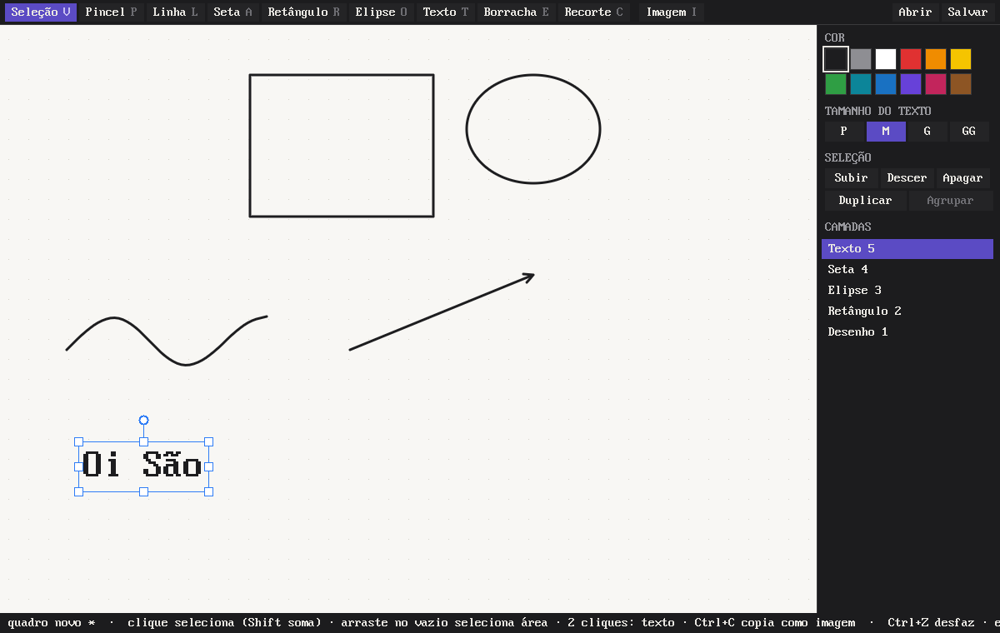
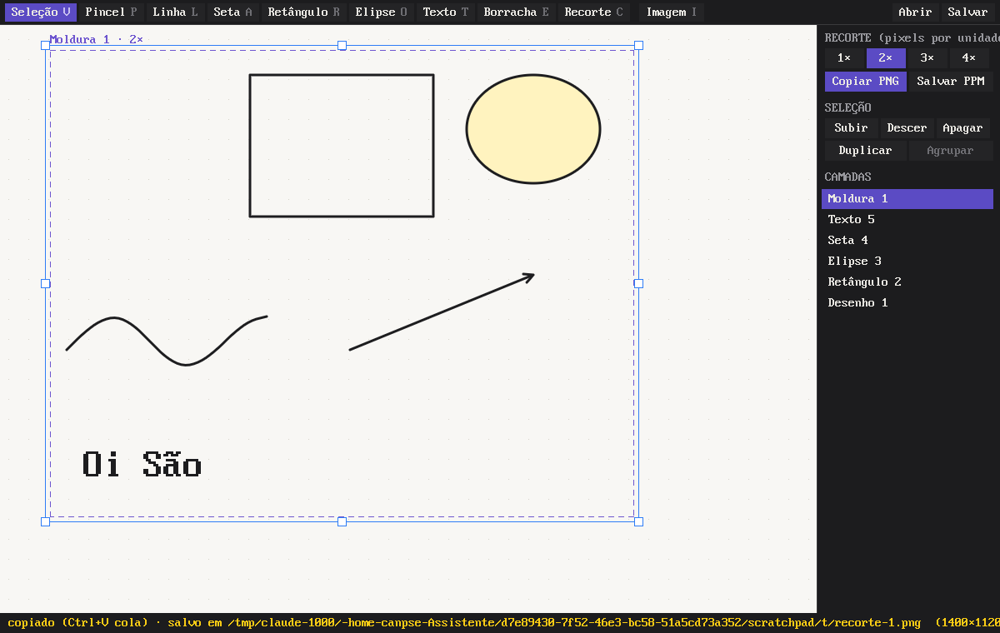

# CG Interativa

Software educacional de Computação Gráfica: **9 aulas interativas**, uma
por tópico da ementa (IFC, 2026.2). Em cada aula você mexe na cena com o
mouse e o teclado, e o painel da direita mostra, ao vivo, os números por
trás da imagem (matrizes, códigos de região, profundidade, a conta da luz).

    zig build run          # abre na aula 1
    zig build run -- 7     # abre direto na aula 7
    zig build test         # testes

| | Aula | Mostra |
|---|---|---|
| 1 | Framebuffer e pixels | matriz de pixels, índice y·largura+x, RGB, tamanho real |
| 2 | Rasterização de retas | DDA, Bresenham (tabela do erro), antialiasing |
| 3 | Transformações 2D | S, R, T e M = T·R·S ao vivo; ordem; giro no centro |
| 4 | Janela -> viewport | mundo x tela, sx/sy, distorção |
| 5 | Recorte de retas | Cohen-Sutherland com códigos de 4 bits e passos |
| 6 | Projeção 3D | pipeline de um vértice (mundo, câmera, clip, /w, tela), perspectiva x ortográfica, vista de cima |
| 7 | Superfícies ocultas | sem remoção, faces de trás, pintor, z-buffer (e ver o z-buffer) |
| 8 | Iluminação e shading | Phong: flat, Gouraud, Phong; a conta no pixel do mouse |
| 9 | Animação | grafo de cena Sol-Terra-Lua, quadros-chave e curvas de tempo |

Tudo sem biblioteca gráfica: a janela fala o protocolo do X11 pelo socket,
cada pixel é escrito num vetor na memória e o 3D tem rasterizador de
triângulos com z-buffer próprio (`src/tres_d.zig`). Aulas em `src/aulas.zig`.
Prints em `docs/prints/aulas/`. Pra gerar prints sem mexer no mouse:
`CG_PRINT=saida.ppm CG_MOUSE=x,y CG_TECLAS=mm zig-out/bin/cg-interativa N`.

O quadro de desenho que veio antes (mesma base) continua: `zig build editor`.
O resto deste arquivo é sobre ele.

---

# Quadro de desenho (editor-cg)

Um quadro infinito pra rabiscar rápido, onde **qualquer pedaço vira imagem
num gesto**: você arrasta a ferramenta Recorte sobre uma região e ela já
está na área de transferência (Ctrl+V em qualquer programa) e salva em PNG.

É diferente de uma ferramenta de captura de tela: o recorte não é uma foto do
que aparece, ele é **gerado de novo a partir do modelo** (os pontos do traço,
o tamanho do retângulo, o texto), na escala que você escolher (1× a 4×). Por
isso sai nítido, sem menu nem alça por cima, e a região fica marcada no
quadro como moldura: mexeu no desenho, recorta de novo com um clique.

Feito do zero em Zig, sem nenhuma biblioteca: trabalho de Computação
Gráfica (IFC, 2026.2). A janela fala o protocolo do X11 pelo socket, cada
pixel é pintado num vetor na memória, e até o PNG (com o compressor deflate)
é escrito aqui.

    zig build run                      # abre o editor (pasta atual)
    zig build run -- ~/desenhos        # pasta dos recortes, quadros e imagens
    zig build run -- aula.quadro       # abre um quadro salvo
    zig build test                     # roda os testes

Precisa de Zig 0.16 e de um servidor X (no Wayland, o XWayland serve, e o
recorte copiado aparece pros programas Wayland também).

## Como usar

Ferramentas na barra de cima, cada uma com a sua tecla (como no Excalidraw):

| Tecla | Ferramenta | |
|---|---|---|
| `V` | Seleção | clique seleciona, `Shift` soma; arrastar no vazio seleciona uma área; dois cliques no vazio criam texto, num texto editam |
| `P` | Pincel | cada traço é um objeto, suavizado ao soltar |
| `L` / `A` | Linha / Seta | da ponta à ponta; `Shift` prende de 15 em 15° |
| `R` / `O` | Retângulo / Elipse | arraste o tamanho; `Shift` faz quadrado / círculo |
| `T` | Texto | clique e digite (acentos pelo layout do sistema); `Enter` termina |
| `E` | Borracha | apaga o objeto que o mouse tocar |
| `C` | Recorte | arraste a região: vira moldura, PNG copiado e salvo como `recorte-N.png` |
| `I` | Imagem | abre um PPM/PGM da pasta (lista dentro da janela) |

- **painel da direita**: cor, fundo (retângulo e elipse), espessura, traço
  liso ou **à mão**, tamanho do texto. Com algo selecionado, muda o
  selecionado; sem nada, muda como a ferramenta vai criar
- **moldura selecionada**: escala do recorte (1× a 4×), `Copiar PNG` (ou
  `Enter`) e `Salvar PPM`
- **alças** na seleção: cantos escalam com proporção (`Shift`: livre), o meio
  dos lados estica, a bolinha gira (`Shift`: de 15 em 15°). Com vários
  selecionados, a caixa é a de todos e transforma todos juntos
- `Ctrl+Z` / `Ctrl+Y` (ou `Ctrl+Shift+Z`): desfazer / refazer
- `Ctrl+C`: copia a seleção como imagem (só ela, sem o que está em volta)
- `Ctrl+D`: duplica; `Ctrl+A`: seleciona tudo; `Ctrl+G` / `Ctrl+Shift+G`: agrupa / desagrupa
- `Delete`: apaga; `Page Up` / `Page Down`: sobe / desce na pilha; setas: empurram 1 (`Shift`: 10)
- `Ctrl+S`: salva o quadro (`quadro-N.quadro` na pasta, ou o que estiver aberto); `Ctrl+O` / `Abrir`: abre
- vista: rodinha dá zoom em torno do cursor; botão direito, do meio ou
  `espaço` + arrastar andam; `Shift+Q` / `Shift+E` giram; `0` volta pra 100%;
  `1` enquadra tudo; `-` / `=` zoom

O `zig build run` compila em ReleaseFast (em Debug o redesenho engasga);
`-Doptimize=Debug` se precisar depurar.

## A computação gráfica por trás

- **modelo → imagem**: nada é guardado em pixels, a não ser as fotos
  importadas e o texto (a fonte é bitmap). Traço é uma lista de pontos,
  retângulo é largura × altura. Cada quadro é pintado de novo a partir disso,
  na resolução da tela ou do recorte
- **coordenadas homogêneas**: cada objeto tem uma matriz 3×3 (objeto → mundo);
  a vista é outra (mundo → tela). Arrastar na tela com a vista girada e com
  zoom: `nova = vista⁻¹ · g · vista · antiga`
- **recorte**: `mundo → imagem = S(escala) · região⁻¹`, a mesma pintura com
  outra matriz
- **traço suave (antialiasing)**: a cobertura de cada pixel vem da distância
  do centro dele ao segmento; uma máscara guarda o máximo, pra borda não
  escurecer onde os segmentos se sobrepõem
- **retângulo e elipse por mapeamento inverso** com **função de distância com
  sinal**: dentro, borda e "perto da borda" (pro clique) são uma conta só
- **suavização de Chaikin** no pincel (cortar cantos converge pra uma
  B-spline quadrática)
- **estilo à mão**: duas passadas tortas por *value noise* com semente fixa
- **algoritmo do pintor**, composição "por cima" com alfa pré-multiplicado,
  interpolação bilinear nas imagens, Bresenham nas linhas da interface
- **descarte**: objeto cuja caixa cai fora da tela nem é pintado

## Onde está cada coisa

- `src/x11.zig`: a janela (conexão, eventos, envio dos pixels, tabela do teclado) e a área de transferência (dono do CLIPBOARD, responde TARGETS e image/png; BIG-REQUESTS pra imagem grande)
- `src/tela.zig`: o vetor de pixels; ponto, disco, Bresenham, traço suave com máscara, tracejado, bilinear e composição por mapeamento inverso
- `src/mat3.zig`: matriz 3×3 em coordenadas homogêneas (translação, escala, rotação, composição em torno de um ponto, inversa, fator de escala)
- `src/camada.zig`: os modelos (traço, linha, seta, retângulo, elipse, texto, imagem, moldura), como cada um se pinta e responde ao clique, estilo à mão, Chaikin; o documento: seleção, grupos, pilha, arrasto, desfazer/refazer (fotos do quadro) e o recorte
- `src/alcas.zig`: alças (referencial da caixa `m`; o arrasto vira `m · g · m⁻¹` na tela)
- `src/png.zig`: gravação de PNG com filtros por linha (Sub, Up, Paeth) e deflate próprio (LZ77 com cadeia de hash + Huffman fixo)
- `src/quadro.zig`: o arquivo `.quadro` (o modelo em texto)
- `src/ppm.zig`: leitura de PPM/PGM em texto e binário; gravação em P3
- `src/fonte.zig` e `src/fonte_dados.zig`: fonte bitmap 8×16 (ASCII + Latin-1), gerada por `ferramentas/fonte_psf.py` da fonte de console `eurlatgr` do kbd (GPL)
- `src/digitar.zig`: de tecla a letra (keysym → Unicode, tecla morta + letra)
- `src/arquivos.zig`: lista de arquivos da pasta (pra escolher dentro da janela)
- `src/ui.zig`: barra de ferramentas, painel de propriedades e camadas, rodapé, lista de arquivos; o mesmo layout desenha e responde ao clique
- `src/main.zig`: o editor (ferramentas, gestos do mouse, atalhos, recorte, arquivos)

